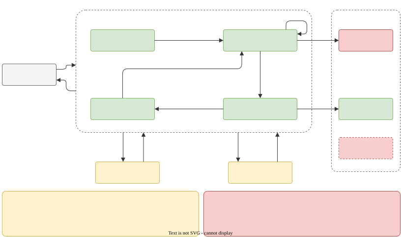

# Navigation

`dharma_navigation` takes the robot to a pose or along a taught route. It never commands the
robot directly: the follower publishes `control/nav_cmd_vel` and the [control mux](Safety.md)
decides what reaches `cmd_vel`.

| Node                      | Role                                                                                      |
| ------------------------- | ----------------------------------------------------------------------------------------- |
| `planner_node`            | `planner/go_to {x, y, yaw}`: plan on `/map`, hand the path to the follower, replan        |
| `path_loader_node`        | `navigation/load_path`: read a route CSV inside `sites_dir`, resample, smooth, publish it |
| `path_follower_node`      | join the route, follow it, final approach, stop points, pause reasons, safety supervisor  |
| `obstacle_avoidance_node` | a reactive policy on `perception/sector_scan` -> `navigation/avoidance`                   |
| `docking_node`            | `docking/dock`: centre on the dock tag, walk in, sit, start charging; `docking/undock`    |

## Go to a pose

```bash
ros2 service call /planner/go_to dharma_interfaces/srv/GoTo "{x: 8.0, y: 4.0, yaw: 1.57}"
ros2 service call /planner/cancel std_srvs/srv/Trigger
```

The planner builds a costmap from `/map` with radii from the [footprint](Robot-Profile.md): cells
closer than the inscribed radius + `costmap.margin` are lethal; up to the circumscribed radius
the **oriented footprint** is checked at the heading the robot will have, so a door narrower than
the body is refused. A\* with line-of-sight shortcuts that never cut corners or diagonal pinches;
a goal inside an obstacle moves to the nearest cell where the robot fits. Arrival is tested
against the goal the plan really ends at. `BLOCKED` or `OFF_PATH` plans again with the obstacles
of the safety scan, up to `monitor.max_replans`; a blind scan is never read as clear. Every
failure stops the follower.

## Follow a route

```bash
ros2 service call /navigation/load_path dharma_interfaces/srv/LoadPath "{path: lobby/routes/<route>.csv}"
ros2 service call /navigation/start std_srvs/srv/Trigger
```

- **Start:** beside the route the robot walks onto it first (`JOINING`, up to
  `join.max_distance`); further away the start is refused.
- **Progress** is searched in a short window ahead and capped per tick, so a parallel leg never
  captures it.
- **Speed profile:** curvature limit, approach speed at stop points, and the braking model
  before every stop; acceleration limited by a forward pass.
- **Stop points:** final x / y / yaw approach, `ARRIVED`, optional inspection hook, dwell,
  `DEPARTED` (`navigation/stop_point`).
- **Loop routes** (`loop_route`) start the next lap unless the battery is low.



| State          | Meaning                                            |
| -------------- | -------------------------------------------------- |
| `INACTIVE`     | not running; one zero command on entering it       |
| `JOINING`      | walking onto the route                             |
| `FOLLOWING`    | following                                          |
| `APPROACHING`  | final approach to a stop point or the goal         |
| `DWELLING`     | at a stop point (the timer is frozen while paused) |
| `PAUSED`       | a pause reason holds: zero every tick              |
| `BLOCKED`      | no progress for `safety.blocked_timeout_sec`       |
| `OFF_PATH`     | too far from the route: stopped, start again       |
| `GOAL_REACHED` | at the end of the route                            |

**Pause reasons:** `operator` (`navigation/pause`, cleared by `navigation/resume`), `estop`
(sticky: cleared only by `navigation/resume` after the release), `remote` (while the mux is in
REMOTE), `localization` (while not localized), `battery` (below `critical_battery`).

**Holds** (zero every tick, named in the status message): `TF_STARTING`, `TF_STALE` (pose older
than `safety.tf_timeout_sec`; between `safety.tf_compensate_sec` and the timeout the pose is
predicted with the odometry twist), `TF_CLOCK` (a pose from the future), `SCAN_STALE`,
`SCAN_BLIND`, `AVOIDANCE_STALE`, `EMERGENCY`.

## Obstacles

Two ways to pass obstacles (`avoidance_mode`):

- **`path_shift`** (holonomic robots, default): slide sideways along a line parallel to the
  route, up to `path_shift.max_offset`, keep the side, return after `path_shift.return_delay_sec`.
  The speed is limited by the free distance at the target offset, the commanded offset and the
  measured offset with the braking model. Near a stop point it waits instead of passing.
- **`reactive`**: the avoidance node's policy (`vfh` by default; `braitenberg`,
  `potential_field`, `follow_gap`) bends the command with a heading offset (rad) and a yaw-rate
  bias (rad/s), the same way in every controller; an obstacle inside the emergency cone stops.

Every command (following, joining, approach) also passes the **motion guard**: limited along its
direction by the 360° safety scan with the footprint and the braking model.

## Docking and charging

`docking_node` docks onto a charger marked by a fiducial tag. The tag detector publishes the
dock tag as a TF frame (`tag.frame`, default `charging_dock`): `apriltag_ros` (tag 4, 36h11) or
the ArUco detector (`fiducials_detector:=aruco`, see [Localization](Localization.md)). Drive to
a pose in front of the dock first (`planner/go_to`, the tag in view), then:

```bash
ros2 service call /docking/dock std_srvs/srv/Trigger     # stops the follower, then docks
ros2 topic echo /docking/status                          # dharma_interfaces/DockingStatus
ros2 service call /docking/undock std_srvs/srv/Trigger   # stop charging, stand, back away
ros2 service call /docking/cancel std_srvs/srv/Trigger
```

```
SEARCHING ─► CENTERING ◄─► APPROACHING ─► SETTLING ─► SITTING ─► CHARGING ─► DOCKED
    └─── a failed attempt: BACKING_OFF ─► SEARCHING (retry.max_retries), then FAILED
UNDOCKING: stop_charge hooks ─► stand hooks ─► back away undock.distance ─► IDLE
```

1. **Centre.** The docked pose is `goal.distance` in front of the tag on its normal, facing it
   (`goal.direction: backward` backs in with a rear camera). An omni / legged robot slides and
   turns until it is within `centering.lateral_tolerance` and `centering.yaw_tolerance_deg` of
   the approach line, for `centering.hold_sec`; a diff robot turns toward the line.
2. **Approach** at up to `approach.speed`, kept centred; drifting beyond
   `centering.realign_lateral` / `realign_yaw_deg` stops it and it centres again. Detections are
   folded into a dock estimate in the odom frame (smoothed, outliers rejected); within
   `approach.blind_distance` the estimate freezes, so the camera may lose the tag at the end.
3. **Settle** for `settle.time_sec`, then check the pose against a fresh look at the tag
   (`settle.*` tolerances). Off: back off `retry.backoff_distance` and try again.
4. **Sit and charge:** the robot driver's `hooks.sit`, then `hooks.charge` (`std_srvs/Trigger`,
   empty: skipped), then wait for `battery` to report `POWER_SUPPLY_STATUS_CHARGING` or `FULL`
   (`charge.confirm_timeout_sec`, 0: do not wait).

Safety: the commands go to `control/nav_cmd_vel` like the follower's; the e-stop or REMOTE ends
an attempt (FAILED, one zero), a mux that has not armed navigation gets neutral commands, and a
robot commanded but not moving for `supervision.stall_timeout_sec` (held by the field) fails
the attempt. **The protective field still applies:** the tag and the dock are in the safety
scan, so the leading edge stops `field.margin` plus the separation term (about 0.31 m with the
defaults) before them. `goal.distance` must leave that room (default 0.75 m with a 0.40 m
front); `docking_node` reads the mux's field values at start and logs an error with the
distance it needs when it does not.

## Controllers

`controller`: `holonomic` (default), `pure_pursuit`, `pid`, `lqr`, `stanley`, `mppi`. Each has
its parameters under `<name>.*`; the controller can be switched at runtime. A product adds its
own through the `dharma.controllers` entry point group (the manual's development chapter has a
complete example package).
